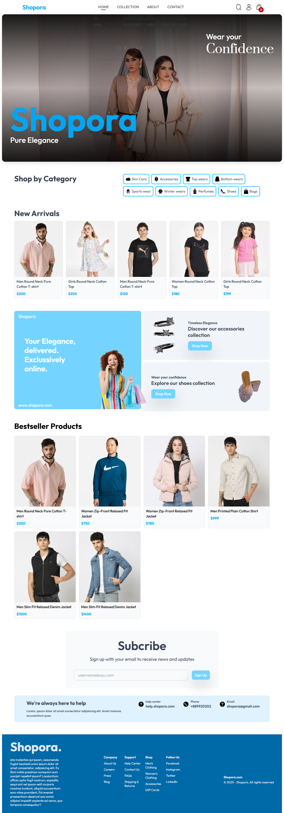
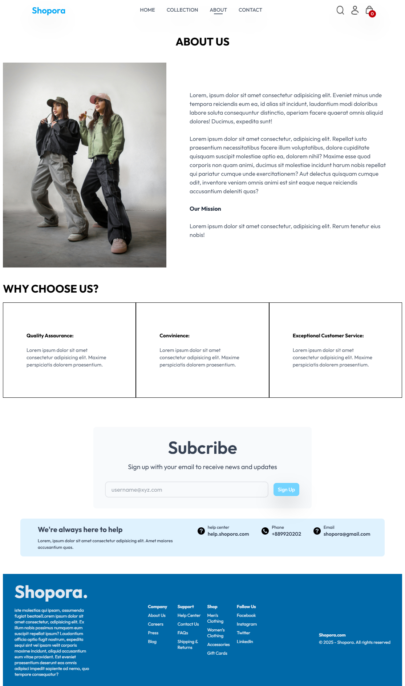

# 🛒 Shopora: Full Stack E-Commerce Website (MERN)

Shopora is a full stack e-commerce web application built with the MERN stack (MongoDB, Express, React, Node.js). It includes a customer storefront, an admin dashboard for managing the store, and a REST API backend.

## Features

**Customer side**
- Product listing and product details pages
- Search and filter products
- Add to cart / remove from cart with automatic total calculation
- User registration and login
- Checkout with **Stripe** online payment or **Cash on Delivery**
- Client-side routing between pages
- Responsive design

**Admin dashboard**
- Secure admin access
- Add, edit and delete products
- Upload product images
- Manage and update customer orders
- View registered users

## Tech Stack
**Frontend & Admin:** React.js, React Router, Context API, CSS
**Backend:** Node.js, Express.js
**Database:** MongoDB
**Authentication:** JWT
**Payments:** Stripe, Cash on Delivery
**Deployment:** Vercel

## What I Practiced
- Building reusable, component-based UI in React
- Managing cart and user state across the app
- Designing REST APIs with Express and connecting them to MongoDB
- Authentication 
- Integrating Stripe payments
- Building a separate admin panel that talks to the same backend

## Project Structure
```
shopora/
├── frontend/    # Customer storefront (React)
├── admin/       # Admin dashboard (React)
└── backend/     # Express server, routes and MongoDB models
```

## Run Locally

**1. Clone the repository**
```bash
git clone https://github.com/AyeshaAfzal-01/shopora.git
cd shopora
```

**2. Start the backend**
```bash
cd backend
npm install
npm start
```

**3. Start the frontend**
```bash
cd frontend
npm install
npm start
```

**4. Start the admin panel**
```bash
cd admin
npm install
npm start
```

## Screenshots


<!-- Add admin dashboard screenshots here -->

## Future Improvements
- JazzCash and Easypaisa payment integration
- Order history and order tracking for customers
- Product reviews and ratings
- Wishlist feature
- Pagination and sorting for large product lists
- Email notifications for orders
- Unit and integration tests

## Author
**Ayesha Afzal**
[GitHub](https://github.com/AyeshaAfzal-01) · [Portfolio](https://ayesha-afzal-portfolio.vercel.app/) · [LinkedIn](https://www.linkedin.com/in/ayesha-afzal01)
